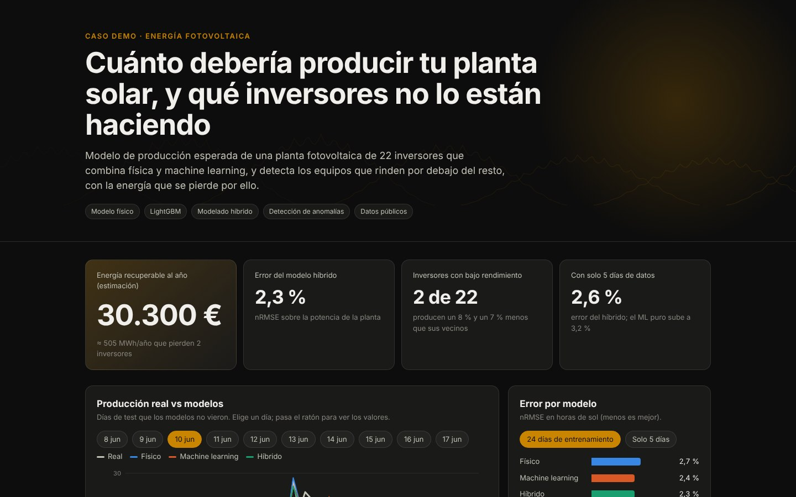

# Solar PV production: physics + AI and inverter health

**Interactive dashboard:** [English](https://alvaromcib.github.io/ia-fotovoltaica-fisica-ml/en/) · [Español](https://alvaromcib.github.io/ia-fotovoltaica-fisica-ml/)



Two things every solar plant operator asks for:

1. **How much should it be producing?** An expected-production model from irradiance and temperature, comparing a **physical** model, a **machine learning** model and a **hybrid** one (physics + ML on the residual).
2. **Which units are losing energy?** Detection of underperforming inverters by comparing each one with its neighbours at the same instant, plus an estimate of the energy and money being lost.

Demo project built on a public dataset (22-inverter plant, 34 days, 15-minute data). No client data is used.

## Results (10 test days)

| Model | nRMSE (24 training days) | nRMSE (only 5 days) |
|---|---|---|
| Physical (1 parameter) | 2.7% | 2.7% |
| Machine learning | 2.4% | 3.2% |
| **Hybrid** | **2.3%** | **2.6%** |

- With enough data, the hybrid is the most accurate and the one that deviates least in total energy.
- With little history (a newly connected plant), pure ML gets worse while the hybrid holds up: physics supplies what the data lacks.

**Inverter health:** 2 of 22 inverters consistently produce 8% and 7% less than the plant median. Extrapolated to a year, that is about 505 MWh, **≈ €30,000/year** at an assumed price of €60/MWh.

> The model uses measured irradiance, so it estimates expected production (useful for detecting losses). Fed with a weather forecast it can forecast production, with a larger error that depends on the quality of that forecast.

## How to run it

```bash
pip install -r requirements.txt
python src/train.py          # models, metrics and inverter health -> results/results.json
python shared/build.py .     # rebuilds docs/index.html (ES) and docs/en/index.html (EN)
```

## How it would apply in a plant

- SCADA data (inverters, string boxes) and the plant's weather station.
- An expected-production baseline per unit, with alerts when an inverter or string drifts.
- Losses quantified in MWh and € to prioritise O&M interventions.

---

**Álvaro Martín Coll** · Physicist · AI engineer for industry and energy · [Malt profile](https://www.malt.com/profile/alvaromartincoll)

Data: *Solar Power Generation Data* (A. Kannal), published on Kaggle; plant 1.
